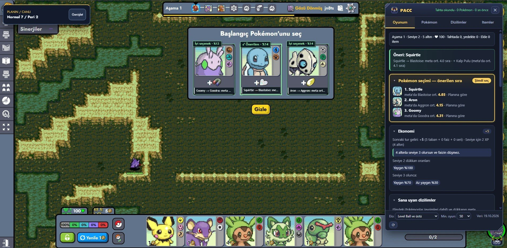
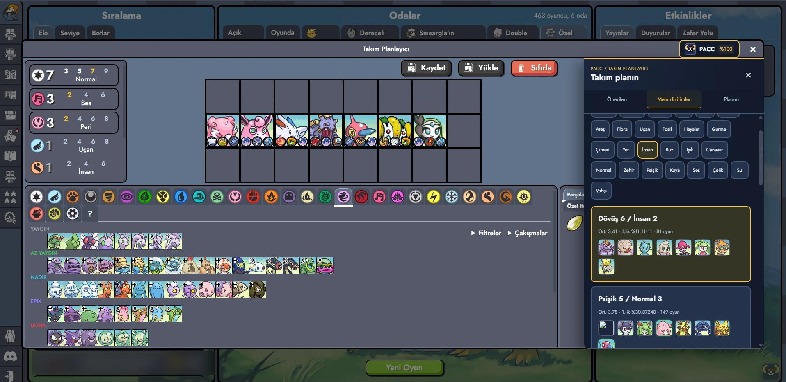
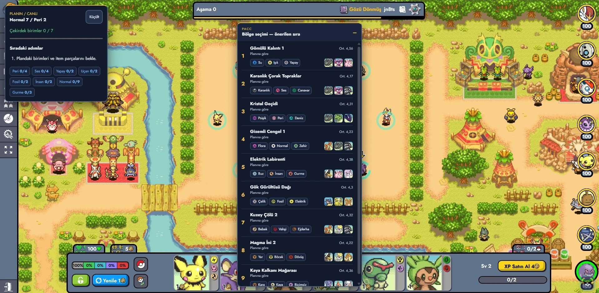

# PACC — Auto Chess Coach


**English** · [Türkçe](README.tr.md)

PACC (Poké Auto Chess Coach) is a Chrome extension for [Pokémon Auto Chess](https://pokemon-auto-chess.com): an in-game coach panel, on-board recommendations, and an optional Turkish translation of the game. It is not an official product and is not affiliated with the game's developers.

**Author:** [badblli](https://github.com/badblli) · **Repository:** [github.com/badblli/pacc](https://github.com/badblli/pacc)



*Starter pick in a real game (Turkish interface): a badge with a fit percentage on every option. The panel on the right (My game tab) shows the suggestion, the pick order for your plan and the economy; the plan tracker is at the top left.*

### Screenshots



*Team Planner coach (Turkish interface): the PACC drawer on the **Meta comps** tab. Filter by synergy, pick a comp by average placement and games played, and load it into the planner.*



*Region portal pick (Turkish interface): PACC ranks the portals by your plan (synergies, sample Pokémon, average placement); the live plan tracker is on the left.*

## Features

- **English and Turkish interface.** The language follows your browser (Turkish if the browser language starts with `tr`, English otherwise). You can change it at any time from the popup (Automatic / English / Türkçe); the panel and the on-board markers switch live. In English, Pokémon, item and synergy names are the game's own English names.
- **On-board recommendations.** In pick windows (starter, additional / unique / legendary Pokémon, item carousel and rewards) and in the shop, the suggested option gets a green frame with a fit percentage and the options to avoid get a red one. Hover a frame to read why. Item crafting hints mark the two components on the board and the Pokémon to drag them onto. **Alt+I** toggles the crafting hints, **Alt+O** hides or shows all markers.
- **Team Planner coach.** Open the game's own Team Planner (**T**, or the planner icon in the lobby) and PACC adds a **PACC** button to its header that opens a side drawer with three tabs: **Recommended** (Pokémon that fit your plan, with a fit % and the reason), **Meta comps** (pick a comp from the meta report and load it into the planner — the game then marks those Pokémon in your shop by itself) and **My plan** (how close your plan is to the best meta comp, missing core units, item plan). During a game a small plan tracker shows your progress and next steps.
- **Carousel and region portals.** During the item carousel and the region portal scene, a card shows the recommended pick order with a short reason for each option.
- **In-game panel** (logo button at the bottom right, or **Alt+P**), with four tabs:
  - **My game:** reads your board, bench, shop and components while you play and suggests:
    - **Pokémon pick:** which option helps your team most,
    - **Item pick:** which item to take from the carousel or a reward,
    - **Craft now:** items you can build from your components, and who should hold them,
    - **Economy:** next round income, interest thresholds, level-up cost, a warning when your HP is low, and shop odds for your level,
    - **Synergies:** thresholds, how many units you need for the next level, and which bench or shop unit completes it,
    - **Shop:** Pokémon in the shop that fit your team,
    - **Opponent:** your next opponent's active synergies and most itemized Pokémon,
    - **Comps that fit you:** meta comps that overlap most with your Pokémon (including evolutions),
    - **Pool and odds** (off by default, enable it in the popup): copies left in the pool and the chance to see one per refresh,
    - **Regional Pokémon:** which of your region's Pokémon fit your team,
    - **Item suggestions:** recommended items for each Pokémon with "ready / 1 component missing" status,
    - **Game summary:** after a game, your placement, the closest meta comp and how your items compare to the meta.
  - **Pokémon:** search any Pokémon (partial names work, e.g. "chari"); see its top 3 items, recipes, descriptions and evolution chain.
  - **Comps:** recent team comps sorted by average placement, each with a core lineup, items and an example team.
  - **Items:** the 10×10 recipe table, item details, and the items whose holders place best.
- **Turkish game translation** (optional): replaces the game's English language file with a Turkish one. It is on by default only when the interface language is Turkish.

All data comes from the game's own public meta report (`/meta-v2`, `/meta/pokemons`, `/meta/items`), built from the last ~100,000 games and refreshed daily.

## Is it safe?

Being careful with extensions is right. Here is exactly what PACC can and cannot do, and how to check it yourself:

- **Runs on one site only.** PACC's only site permission is `https://pokemon-auto-chess.com/*`. It cannot see any other tab or website.
- **Talks to one server only.** The only address in the code is `https://pokemon-auto-chess.com`, used for the game's public meta report. No analytics, no tracking, no server of its own, nothing about you is sent anywhere. See [PRIVACY.md](PRIVACY.md).
- **Never plays for you.** It does not click, drag, buy or send anything to the game. It only draws badges and panels on top of the page. The one thing it changes is your own Team Planner, and only when you press **Load into plan** (the planner is stored in your browser).
- **No hidden code.** Everything is in this repo (GPL-3.0). There is no remote code and no minified bundle; the release zip is built from the `extension/` folder by `npm run pack`.
- **Few permissions.** `storage` (settings and the meta cache), `alarms` (check the meta report every 6 hours), `declarativeNetRequest` (only for the optional Turkish translation).

**Check it yourself:** on `chrome://extensions` open PACC → *Details* to see the permissions; or open DevTools → *Network* while playing and you will only see requests to pokemon-auto-chess.com.

## Installation (2 minutes)

PACC works in Chrome, Edge, Brave and Opera.

1. **Download** `PACC-vX.Y.Z.zip` from the [latest release](https://github.com/badblli/pacc/releases/latest) and **unzip** it (right click → *Extract All*).
2. Open `chrome://extensions` (Edge: `edge://extensions`).
3. Turn on **Developer mode** (top right).
4. **Drag the unzipped folder** onto the page, or click **Load unpacked** and pick it.
5. Open [pokemon-auto-chess.com](https://pokemon-auto-chess.com) and start a game. Advice appears on the pick windows and the shop; press **Alt+P** (or the logo at the bottom right) for the panel.

Keep the unzipped folder where it is: Chrome loads the extension from it. To update, download the new zip, replace the folder's contents and press ⟳ on the PACC card.

> The interface follows your browser language (English or Turkish); change it from the PACC toolbar icon. The Turkish game translation only applies when the game's own language is **English**.

### From source (developers)

Clone the repo and load the `extension` folder with **Load unpacked**. After changing code, press ⟳ on the extension card and reload the game tab. `npm run pack` builds the release zip.

## How it works

| File | Purpose |
|---|---|
| `extension/manifest.json`, `extension/_locales/` | Manifest; the name and description are localized (`default_locale: "en"`). |
| `extension/rules/tr_redirect.json` | `declarativeNetRequest` rule that redirects the game's `locales/en/translation.json` to the extension's Turkish file. |
| `extension/background.js` | Checks the meta report every 6 hours, downloads it if it changed, shrinks ~40 MB to ~1 MB and stores it in `chrome.storage`. Sets the translation default from the interface language on install. |
| `extension/page/game-hook.js` | Runs in the page's own JS context. Reads the game's Redux store and Colyseus state and posts a summary of **your** team once a second. Never sends anything to the game. |
| `extension/content/i18n.js` | Interface language helper (`PacI18n.t`), loaded before the other content scripts and in the popup. |
| `extension/i18n/en.json`, `extension/i18n/tr.json` | Interface strings (panel, on-board markers, popup, advice reasons). Both catalogs must have the same keys. |
| `extension/i18n/game.en.json` | The game's English names and item descriptions for the English interface (generated, see below). |
| `extension/content/advisor.js` | Advice engine: comps, items, shop, carousel, synergies, economy, pool, opponent and region advice from the game summary + meta data. Uses the game's real rules (shop odds, pool sizes, interest). |
| `extension/content/overlay.js` | Draws the on-board frames, badges and crafting hints in a separate shadow DOM layer. Never clicks or drags. |
| `extension/content/panel.js` | Adds the panel to the page in a shadow DOM. Typing in the panel does not trigger the game's shortcuts. |
| `extension/popup/` | Settings popup (language, translation, panel, markers, pool tracking, data status). |
| `extension/data/static.json` | Item recipes, portrait indexes, evolution families, types, duos and shop rules extracted from the game's code (generated). |
| `extension/locales/tr/translation.json` | The merged Turkish game language file (generated). |
| `extension/icons/` | Logo (`logo.svg` and PNGs generated by `scripts/build-icons.mjs`). See [docs/branding.md](docs/branding.md). |

## Development

```bash
node tests/advice.test.mjs   # advice engine (Turkish catalog, strict keys)
node tests/i18n.test.mjs     # catalogs, key usage, English/Turkish advice, hard-coded text scan
```

Browser harnesses (no extension needed) live in `tests/panel-harness.html` and `tests/overlay-harness.html`; open them from a local server at the repository root. Both accept `?lang=en|tr`; the panel harness runs its checks with `?autotest=1`.

Adding interface text: add the key to **both** `extension/i18n/en.json` and `extension/i18n/tr.json`, then use `t("key", { var })` (plain text) or `h("key", { var })` (HTML-safe) in the code. Placeholders use `{{name}}`; plurals use `key_one` / `key_other` with a numeric `count`.

Regenerating the English game names after a game update:

```bash
node scripts/build-i18n-game-en.mjs [path/to/en/translation.json]
```

## Working on the Turkish game translation

Translations live in `translations/tr.partial.json`. It has the same structure as the game's `en/translation.json` but contains only the translated keys; any key not listed there stays in English in the game.

```bash
npm run build:tr
```

This fetches the current English file from GitHub, applies the Turkish translations on top and prints the translated share. It warns when a translation is missing one of the game's placeholders.

Rules:
- UPPER_CASE words such as `SHIELD`, `ON_HIT`, `ATK`, `BURN`, `{{variables}}` and patterns like `[50,LK]` must stay **as is**; the game turns them into icons and colored labels.
- Don't attach Turkish suffixes to these tokens. The game won't recognize `SHIELDı`; write `SHIELD olarak`.
- Item and Pokémon names are intentionally kept in English (guides and the community use them).

When the game adds new items or Pokémon:

```bash
npm run build
```

> In the long run the best option is adding Turkish to the game itself through its translation page (https://pokemon-auto-chess.com/translations), so everyone can use it without an extension.

## Reading the data

- "Most used items" in the panel are the items players **equip most often**. They are a good starting point, not proven best items.
- **Avg. placement** runs from 1 to 8, 1 is best. The elo filter shows games "at this level and above". High elo levels can have few games; the panel marks a small sample with ⚠.
- "Items whose holders place best" can be misleading: items that go to strong Pokémon naturally look better.

## The game's rules

The game's terms of use forbid unauthorized automation or tools. This extension never clicks, never makes moves and never sends messages to the game. The "My game" tab and the on-board markers only show advice based on information already in your browser. The opponent summary shows what you could see by clicking their board. "Pool and odds" counts every player's board, so it is the greyest feature and is off by default. Before sharing the extension widely, it is still a good idea to ask the developers on the game's Discord.

## License

The game is licensed under GPL-3.0. This extension contains no game code; it only derives the language file and item recipe data from the game's repository. If you publish the extension, GPL-3.0 is the simplest choice.

## Record a match and send it to developers

Open the extension popup and enable **Record match (developer)** before playing. Recording is off by default. After the match, turn it off, then click **Download recording (n states)** and send the resulting `pacc-game-YYYYMMDD-HHMM.json` file to the developers. **Delete recording** clears the local capture; delete an old capture before starting a separate match.

Player names and IDs are anonymized and avatar fields are removed before storage. The capture keeps at most about 8 MB, dropping the oldest events when full; it does not contain the meta database. Review the JSON before sharing. Turning recording off retains the existing capture for download.

Developers: put recordings in `tests/fixtures/games/` and run `node --test tests/replay.test.mjs`. `sample-synthetic.json` is a hand-written example, not a real match. For visual replay, serve the repository root (`python -m http.server 8123`), open `http://localhost:8123/tests/replay-harness.html?file=fixtures/games/sample-synthetic.json`, or choose a local recording. Scrub events with the slider; use the original viewport size for recorded overlay coordinates. Replay uses the repository's meta fixture and current default settings, so historical recommendations may differ.
